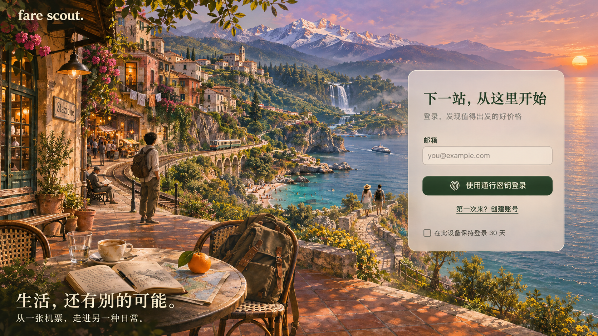

# 登录页概念：生活，还有别的可能

2026-11-04 用户确认此概念并授权提交。使用内置 image_gen 生成。

## 设计意图

前景的咖啡、笔记与背包连接熟悉的日常；沿海铁路引向小镇、海湾、瀑布和雪山，表达出发之后可以体验的不同生活。丰富细节集中于左侧及中景，右侧开阔海面承托奶白磨砂玻璃登录卡片，保留风景的连续性。

主文案：生活，还有别的可能。副文案：从一张机票，走进另一种日常。

## 生成提示词核心记录

High fidelity desktop login screen concept for “fare scout.”, wide 16:9. Full bleed cinematic travel illustration, detailed painterly realism with analog film atmosphere. Concept: “The lives we have not yet lived.” One coherent imaginative landscape, not a postcard collage. A sun warmed railway station terrace, terracotta tiles, coffee, open notebook, backpack and orange on a map; a traveler looks outward. A winding coastal railway connects a Mediterranean hillside old town, market alley, forest waterfall, distant snow peaks, azure cove, tiny ferry and swimmers, and a couple on a cliff path. Human scale details reward close looking. Golden late afternoon, violet dusk mountains, petrol sea, apricot sun, moss foliage and warm stone. Left 65% rich detail; right 35% calm sea and sky. Seamless background behind a right centered warm ivory frosted glass login card, approximately 78% opaque, delicate border and soft shadow. Small “fare scout.” wordmark top left. Bottom left: “生活，还有别的可能。” and “从一张机票，走进另一种日常。” Card: “下一站，从这里开始”, “登录，发现值得出发的好价格”, “邮箱”, “you@example.com”, “使用通行密钥登录”, “第一次来？创建账号”, “在此设备保持登录 30 天”. Dark forest green controls, readable Chinese typography. No passwords, social logos, prices, charts, browser chrome, watermark or presentation border.

## 验证与边界

已目视检查生成图的构图、细节、中文文案与登录卡片层次。此文件是包含背景及登录框的完整静态概念图，图中的控件与文字属于图片内容；尚无独立纯背景资产，也未接入正式登录页。实际实现须使用全局字体、主题入口及真实认证流程，并另行验证电脑和手机界面。此次仅保存设计稿与说明，不涉及运行代码、查价、通知或部署。

## 2026-11-04 · 接入实际登录页（本地待验收）

- 从已确认概念图编辑生成无字、无控件的纯背景，内置 image_gen 输出 1672×941 PNG，转为 863,906 字节的 JPEG，作为 `app/static/assets/login-scene/possibilities-background.jpg`。原始生成文件保留在工具输出目录，网站只引用项目内 JPEG。
- 编辑提示词：Edit this approved login concept into its clean production background plate. Remove ALL overlaid UI: remove top left fare scout wordmark, both bottom left Chinese text lines, and the entire frosted login card on the right including all text, border, fields, buttons and shadow. Reconstruct the natural sea, coastline, distant hills and sky behind the removed card seamlessly. Preserve the existing landscape composition, traveler, terrace table and notebook, orange, backpack, old town, train, mountains, waterfall, swimmers, walking couple, sunset, color palette, lighting and painterly realism as closely as possible. Right 35% should remain calm open sea and sky suitable behind a real HTML login card. Absolutely no text, logos, UI elements, frames or watermark. Same wide landscape composition and aspect ratio.
- `auth-scene.css` 负责全屏背景、右侧悬浮表单和手机布局；桌面卡片底色 79% 不透明，手机 85%，背景模糊 18px。不另设字体或覆盖主题语义变量，表单与按钮继续使用全局主题。保留小熊猫及现有密码／通行密钥认证逻辑；通行密钥登录仍使用设备发现账号，不添加无效邮箱字段。
- 本地预览：http://localhost:8787 。通过现有 npm dev 启动脚本运行 Wrangler 本地模式，命令行关闭邮件与查价并将通行密钥来源设为本地地址；未修改发布配置。Python 静态白名单同步加入新 CSS 与背景。
- 浏览器实际检查桌面、390px 登录及 320px 注册，均无横向溢出；注册／返回登录切换正常。长表单可纵向滚动。旧书纸与松林夜色主题切换后，卡片颜色和文字随全局设置变化，验收后恢复旧书纸。页面控制台无错误／警告。截图：`/tmp/fare-login-possibilities-desktop.jpg`。
- 90 项前端测试通过，JS 语法、Python 编译、差异空白检查通过；本地 session API 与背景返回 HTTP 200。实际点击通行密钥登录进入认证等待，本次未完成真实设备认证，也未注册账号；不视为端到端登录验收通过。未查价、发送通知、commit、push 或部署。

- 补充验证：现有本地认证 HTTP 测试 9 项全部通过，使用临时数据库与回环服务，未改动实际账号。
